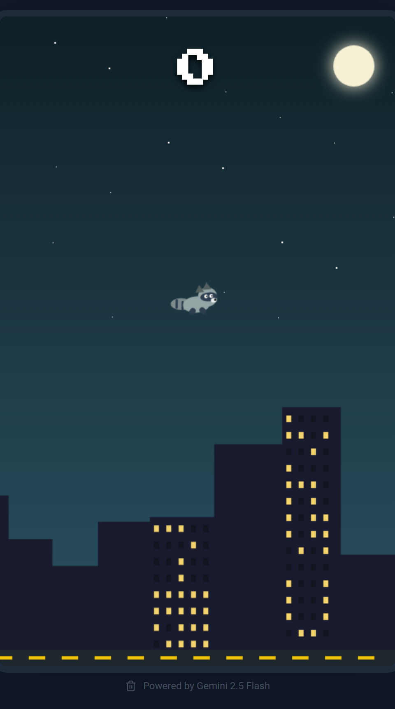

# Trash Panda Flight

A night-city flier. Keep the raccoon in the air, slip through the pipes, and grab trash on the way. Crash, and a raccoon roasts the score.

Play it: https://mkmviclee.github.io/trash-panada-filghs/



[Watch a round](media/gameplay.mp4)

## How to play

Click, tap, or press Space, Arrow Up, or Enter to flap. The first press starts the round.

- Passing a pipe scores 1.
- Trash floating in the gap scores 2.
- The ceiling, the road, and the pipes all end the round.
- The best score stays in this browser.

## Run locally

Requires Node.js.

```bash
npm ci
npm run dev
```

Open http://localhost:3000.

## Scripts

| Command | What it does |
| --- | --- |
| `npm run dev` | Dev server on port 3000. Uses `index.dev.html`. |
| `npm run build` | Production build in `dist/`. |
| `npm run preview` | Serve the `dist/` build. |
| `npm run build:pages` | Rebuild the bundle GitHub Pages serves. |

GitHub Pages publishes the repository root of this branch. `npm run build:pages` rewrites the root `index.html` and `assets/` with relative paths, and refreshes `.nojekyll`. Commit those files after a pages build.

## Android

`npm run build:android` copies a fresh web build into the Android project. With the Android SDK installed:

```bash
cd android && ./gradlew assembleDebug
```

The debug APK is `android/app/build/outputs/apk/debug/app-debug.apk`. The package name is `com.trashpanda.flight`.
